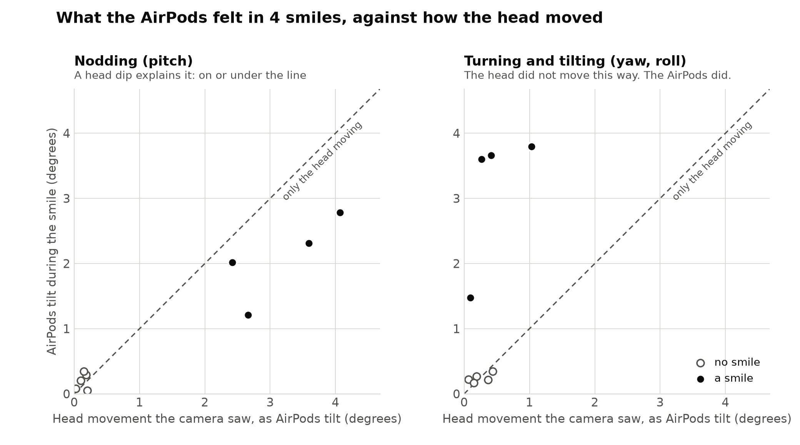

# What AirPods can and cannot carry: the evidence

Every source below was opened on 14 Nov 2026. Local copies and search outputs: `/bulk2/runs/depression/judging/round-5/evidence-sources/` (older abstracts in `/bulk2/runs/depression/science/sources/`). Where only the abstract could be opened, the entry says so. Rows for `claims.md` are numbered 64 onward.

Rule, as before: these papers are about groups of people, cameras, wrist sensors or research earbuds. None of them is about AirPods and depression. Nothing here is our result.

---

## 0. Our own measurement: a smile moves the earbud, not only the head

This one is ours, measured on our own minutes. It is the only part of this page that is our result.

**The question.** When Touko smiles, the AirPods' angles shift by a few degrees. Is that the earbud moving with the cheek, or only his head dipping?

**How.** A teaching minute keeps the AirPods' angles (50 a second) next to what the camera saw, and the camera gives the head's own pitch, yaw and roll. In the nod and the head shake the head truly moves, so those parts give the map from head movement as the camera sees it to what the AirPods then feel (AirPods pitch follows camera pitch at 0.74 degrees per degree, fit 0.83). For each smile the map says how much AirPods tilt the head movement accounts for. Anything beyond that is the earbud moving in the ear. Nothing is fitted to the smiles themselves. Script: `pitch/evidence/smile_tilt.py`.

**Result** (one real minute, 14 Nov 2026, iPhone and AirPods Pro, 4 of the 5 smiles asked for could be measured):

- **Turning and tilting (yaw and roll): the earbud moves.** In each smile the AirPods turned 3.6 degrees (median). The head movement the camera saw accounts for 0.3 degrees. 3.4 degrees is left. The same measure on stretches with no smile leaves 0.3 degrees (largest 0.46). All 4 smiles are above that, and what is left points the same way every time (about +2.0 yaw, -2.3 roll).
- **Nodding (pitch): we cannot claim it.** The AirPods dipped 2.2 degrees, and the camera says the head dipped enough to account for 3.1. Either he dips his head a little when he smiles, or the camera's face fit reads a smile as a dip. This minute cannot tell which.

**What we say.** The AirPods feel a smile as a turn and tilt of about 3 degrees that the head did not make. We do not say the dip is the smile.

**What this does not show.** One person, one minute, 4 smiles, asked for and not spontaneous, one pair of AirPods Pro and one fit in the ear. It says nothing about other people, and nothing about depression. The recordings are a person's own movement and are not in this repo.

---

## 1. Head movement and depression

**Alghowinem et al. 2013.** "Head pose and movement analysis as an indicator of depression." ACII 2013, pp. 283-288. doi:10.1109/ACII.2013.53 (full PDF, ANU open repository).
- Finding: depressed people made slower head movements, changed head position less, and spent longer looking down and to the right. A model that never saw the test person told the groups apart with 71.2% average recall.
- Sample: 30 people with severe depression and 30 controls, clinical interviews, video.
- Does not show: change within one person. It compares two groups once, on camera.

**Girard et al. 2014** (already rows 10 to 12). Image Vis Comput 32(10):641-647. doi:10.1016/j.imavis.2013.12.007 (PMC4217695).
- Finding: "Head amplitude and velocity were decreased in high severity interviews."
- Sample: 19 people, 38 interviews, the same people when severe and when eased; SSRI or psychotherapy.
- Does not show: TMS, daily life, or anything an earbud measured.

**Dibeklioglu, Hammal, Cohn 2018.** "Dynamic multimodal measurement of depression severity using deep autoencoding." IEEE J Biomed Health Inform 22(2):525-536. doi:10.1109/JBHI.2017.2676878 (full text, PMC5581737).
- Finding: head movement dynamics alone sorted sessions into three severity levels with 65.25% mean accuracy (remission 62.16%, mild 54.29%, moderate to severe 79.31%), checked on people the model never saw. Face did better (72.59%), voice worse (44.44%).
- Sample: 57 recruited, 49 analysed, 130 sessions, HRSD interviews at weeks 1, 7, 13 and 21 of SSRI or psychotherapy.
- Does not show: an earbud signal, or a prompt like ours. The head was tracked by camera during a clinical interview.

**Kacem, Hammal, Daoudi, Cohn 2018.** "Detecting depression severity by interpretable representations of motion dynamics." FG 2018, pp. 739-745. doi:10.1109/FG.2018.00116 (full text, PMC6157749).
- Finding: same 49 people. Head 61.43%, face 66.19%, both 70.83% over three severity levels. Movement got faster as people improved from severe to mild to remitted (shown most clearly for the face).
- Does not show: anything outside the clinic interview.

**Grant et al. 2025.** Systematic review, Front Psychiatry 16:1643042. doi:10.3389/fpsyt.2025.1643042 (full text, PMC12754059).
- Finding: as patients with depression improved, head movements increased in 5 of 14 studies, facial expressivity and positive valence in 6 of 14, and smiling in 4 of 18. One study (Gaebel and Wölwer 2004) found expressivity fell as symptoms improved.
- Their words: "The existing evidence is presently insufficient to establish distinct behavioural profiles for clinical improvement."
- Does not show: a validated marker. Most studies found no change, and they used many different methods.

**Ozturk et al. 2024.** Psychol Med 54(12):3507-3518. doi:10.1017/S0033291724002010 (full text, PMC11496224).
- Finding: in girls who had never been depressed, MORE average head movement during an interview predicted a first depression within 3 years (odds ratio about 1.49). Nonverbal markers together: AUC 0.70.
- Sample: 359 adolescent girls; 70 (19.5%) had a first onset.
- Does not show: that less movement always means worse. Here the direction is the opposite, so we say "change from your own usual", never "slower is worse".

**Burton et al. 2013.** Meta-analysis of actigraphy in depression. J Affect Disord 145(1):21-28. doi:10.1016/j.jad.2012.07.001 (abstract).
- Finding: daytime activity was lower in depression (standardised mean difference -0.76, 95% CI -1.05 to -0.47). During treatment it rose (0.53, 0.20 to 0.87) and night activity fell (-0.36).
- Sample: 19 papers from 16 studies, 412 patients, wrist sensors.
- Does not show: head motion, earbuds, or relapse. Most studies were not blinded.

**Earbuds and depression.** A Europe PMC search on 14 Nov (earable, earbud or in-ear, with depression and IMU or accelerometer, `q-earable-depression.txt`) found no study that used earbud motion to follow depression. We are not aware of one.

---

## 2. Smiling, laughter and how much the face moves

**Davies et al. 2016.** Neurosci Biobehav Rev 64:252-271. doi:10.1016/j.neubiorev.2016.02.015 (abstract).
- Finding: across 39 studies, people with depression showed less facial expression mainly for positive feelings.
- Does not show: change over time in one person.

**Sloan, Strauss, Wisner 2001.** J Abnorm Psychol 110(3):488-493. doi:10.1037//0021-843x.110.3.488 (abstract).
- Finding: depressed women showed fewer and weaker facial expressions to pleasant pictures only, not to unpleasant ones.
- Sample: 20 depressed and 20 non-depressed women, facial muscle recordings.
- Does not show: men, treatment, or anything outside a lab.

**Reed, Sayette, Cohn 2007.** J Abnorm Psychol 116(4):804-809. doi:10.1037/0021-843X.116.4.804 (abstract).
- Finding: watching a comedy clip, people with current symptoms were more likely to mix their first smiles with negative expressions.
- Sample: 116 people, coded by hand (FACS).
- Does not show: that they smiled less. The abstract does not say that, so we must not either.

**Plevin et al. 2026.** Systematic review. Digit Biomark 10(1):41-52. doi:10.1159/000550413 (full text, PMC12916120).
- Finding: across 12 studies and 389 participants, response to treatment went with more facial expressivity.
- The only rTMS study had 9 people and used still photos and eyebrow measures.
- Does not show: a TMS result anyone could build on.

**Navarro et al. 2014.** J Affect Disord 160:43-49. doi:10.1016/j.jad.2014.02.035 (abstract).
- Finding: the sound of laughter separated patients from controls 88% of the time; it sorted severity correctly 85.47% of the time in men and 66.17% in women.
- Sample: 30 patients and 20 controls, 934 laughs, audio.
- Does not show: motion, earbuds or follow-up.

**Ethofer et al. 2025.** Sci Rep 15:14724. doi:10.1038/s41598-025-97385-6 (full text, PMC12034789).
- Finding: people with depression read the social intent of laughter more negatively, and more so the more severe they were.
- Sample: 48 with major depression, 52 controls.
- Caveat for us: a played laugh may land differently on a bad day. That could be part of the signal, or noise.

**Tamada et al. 2026.** J Affect Disord 392:120209. doi:10.1016/j.jad.2025.120209 (abstract).
- Finding: older adults who said they never laughed were more likely to develop depression over 6 years (relative risk 1.49).
- Sample: 32,666 Japanese adults aged 65 and over, self-report.
- Does not show: cause, or anything a sensor measured.

---

## 3. Earbud motion sensors reading the face and head

The plain gap first. Every study below used research earbuds or custom prototypes sampling 30 to 130 times a second, mostly posed expressions, often cut into labelled windows by hand or by button, and often with both earbuds. AirPods give apps a fused head pose stream. Apple's page for `CMHeadphoneMotionManager` documents no sample rate. Two papers that used AirPods report 25 times a second, the maximum the API allowed them. Whatever the real numbers are on our hardware, we measure them: **[EAR: hz]**.

| Study | Earbud | Rate | People | What it read | Score |
|---|---|---|---|---|---|
| Verma et al. 2021 (ExpressEar) | eSense, both ears | 50 Hz | 12 | 32 posed facial action units | 89.9% per person; 42.1% for one model on new people |
| Lee et al. 2019 (Kinetic Earables) | prototype | 130 Hz | 9 | smile, frown and other expressions, seated | F1 0.85 (smile 0.89); 0.80 on new people |
| Min, Mathur, Kawsar 2018 | eSense prototype | 100 Hz | 10 | nod, shake, nothing | F-score 80% |
| Gashi et al. 2021 | earbud IMU | not opened | not opened | nod, shake, smile, talk, yawn | nod vs shake F1 88.24; smile vs talk vs yawn 45.42 |
| Ketmalasiri et al. 2024 (IMChew) | eSense | 60 Hz | 8 | chewing vs not (incl. smiling, talking) | 0.91 on new people |
| Yao et al. 2025 (IMUFace, preprint) | custom | 30 Hz | 12 | 7 posed expressions as face landmarks | 2.21 mm error per person |
| Röddiger et al. 2019 | eSense | 50 Hz | 12 | breathing rate | 2.6 breaths a minute off |
| AirPods (EarDA, Suite-IN) | AirPods Pro 2, AirPods 3 | 25 Hz | n/a | used for activity and position | n/a |

**Verma et al. 2021, ExpressEar.** Proc ACM IMWUT 5(3):129. doi:10.1145/3478085 (full PDF from the author's site).
- Finding: with a model for each person, 89.9% (SD 3.5) across 32 posed facial action units, 5-fold cross-validation. With one earbud only: 79.6% left, 79.3% right. One model for everyone, tested on people it never saw: 42.1% (SD 7.3), where chance is 3.1%.
- Sample: 12 people aged 19 to 23, 4 women, 3 of them co-authors.
- Telling expressions apart from eating and speaking: 99.2% per person, but in 3 people and on 2-second windows that overlap every 0.1 s. Our reading: overlapping windows in different folds can flatter the score.
- Does not show: spontaneous expressions, AirPods, 25 Hz, or anything about mood.
- This is the primary source for row 27, which was second-hand until now.

**Lee et al. 2019, Kinetic Earables.** Augmented Human 2019. doi:10.1145/3311823.3311869 (full PDF).
- Finding: seated, F1 0.85 over expressions (smile 0.89) with 10-fold cross-validation; 0.80 for people the model never saw. Standing 0.80, walking 0.71.
- Sample: 9 men in their 20s and 30s. Each expression was cut out with a button press, up to 3 s.
- Does not show: talking, natural smiles, or a low sample rate.

**Min, Mathur, Kawsar 2018.** "Exploring audio and kinetic sensing on earable devices." WearSys 2018, pp. 5-10. doi:10.1145/3211960.3211970 (full PDF).
- Finding: nod, shake or nothing, F-score 80% with accelerometer and gyroscope, 79% with the accelerometer alone.
- Sample: 10 people, 100 Hz.
- Does not show: AirPods or anything clinical.

**Gashi et al. 2021.** ICMI 2021, pp. 168-176. doi:10.1145/3462244.3479921 (abstract only; the full text was behind a bot wall).
- Finding: head vs mouth activities F1 84.79; nod vs shake 88.24; smile vs talk vs yawn 45.42.
- Does not show: we could not open the sample size or rate, so we quote only the abstract's figures.

**Ketmalasiri et al. 2024, IMChew.** BodySys 2024 (MobiSys workshop). doi:10.1145/3662009.3662022 (full PDF; the PDF itself prints the main conference's DOI, Crossref gives this one).
- Finding: chewing against everything else (including smiling and talking), accuracy and F1 0.91 on people the model never saw.
- Sample: 8 people aged 20 to 60, eSense at 60 Hz.
- Why it matters to us: a smile and a chew both move the jaw near the ear. Eating will look like smiling unless the model learns otherwise.

**Yao et al. 2025, IMUFace.** arXiv:2501.02177 v3 (preprint, not peer reviewed).
- Finding: from 5 minutes of a person's own data, face landmarks were placed to within 2.21 mm (NME 3.40%). Starting from other people and adding 2 minutes of the person's data: 2.05 mm. One earphone: 2.40 and 2.36 mm. A model for everyone did worse.
- Sample: 12 people (9 men), custom earphones at 30 Hz, 7 posed expressions.
- Does not show: AirPods or real-life use.

**AirPods sample rate.**
- Lyu et al. 2024, EarDA, arXiv:2406.16943: AirPods Pro 2 motion "set to the highest value allowed by API, which is 25 Hz".
- Sun et al. 2024, Suite-IN, arXiv:2411.07828: AirPods 3 motion "sampled at 25 Hz ... the maximum rate of the AirPods".
- Apple, developer.apple.com/documentation/coremotion/cmheadphonemotionmanager (row 31): no rate and no interval setting documented.
- Does not show: what our AirPods give on our Mac today. **[EAR: hz]**.

---

## 4. Heart rate and breathing from the ear

**Doherty et al. 2026.** "Accuracy of heart rate measurement using AirPods Pro 3 during graded treadmill exercise." PLOS Digit Health 5(4):e0001373. doi:10.1371/journal.pdig.0001373 (full text, PMC13132241).
- Finding: against a Polar H10 chest strap, mean difference -0.03 bpm (95% CI -0.22 to 0.17); limits of agreement -10.27 to 10.22 bpm; mean absolute error 2.08 bpm overall and 1.31 bpm at rest; 2.02% error.
- Sample: 40 healthy adults (mean age 23.8, 37.5% women), 16,735 five-second epochs. People on heart-rate drugs were excluded.
- How: recorded during workout sessions through Apple's Fitness and Health frameworks, firmware 8B25, iOS 26.1, exported with a third-party app.
- Does not show: heart rate outside a workout, beat-to-beat timing, heart rate variability, or patients on antidepressants. Apps get heart rate only while a workout runs (row 30), and not on a Mac.

**Röddiger et al. 2019.** "Towards respiration rate monitoring using an in-ear headphone inertial measurement unit." EarComp 2019, pp. 48-53. doi:10.1145/3345615.3361130 (full PDF).
- Finding: breathing rate from earbud motion was off by 2.62 breaths a minute (accelerometer) and 2.55 (gyroscope), in 20-second windows. "Performance varies drastically between participants."
- Sample: 12 people (2 women), eSense at 50 Hz, nasal cannula reference, sitting still.
- Does not show: AirPods, 25 Hz, or reliable single readings.

Apple's own claims about the AirPods Pro 3 sensor stay as rows 29 and 30.

---

## 5. Relapse after TMS, and whether watching between visits changes what a clinic does

The existing rows stay as they are: Senova 2019 (row 2), Janicak 2010 (row 3), Philip 2016 (row 4), Dine 2026 (rows 5, 6). Kroenke 2003 was not in the table; it is added as row 79 below.

**Guo et al. 2015.** Am J Psychiatry 172(10):1004-1013. doi:10.1176/appi.ajp.2015.14050652 (abstract).
- Finding: when clinicians got rating scale scores to act on, more patients responded (86.9% vs 62.7%) and remitted (73.8% vs 28.8%), and treatment was changed more often (44 vs 23 adjustments).
- Sample: 120 outpatients in China (61 vs 59), 24 weeks, antidepressants.
- Does not show: sensors, relapse, or TMS. It is acute treatment with rating scales.

**Astill Wright et al. 2026.** Systematic review. JMIR Ment Health 13:e84020. doi:10.2196/84020 (abstract).
- Finding: 8 RCTs, 1,230 participants. "Absence of evidence on the effect of mood monitoring on decreased relapse rates or readmission rates."
- Does not show: that monitoring fails. It shows no trial has proven it works for relapse.

**Faurholt-Jepsen et al. 2026, SmartBipolar.** Int J Bipolar Disord 14:17. doi:10.1186/s40345-026-00418-w (abstract).
- Finding: smartphone monitoring with feedback to the clinic did not change outcomes.
- Sample: 201 patients with bipolar disorder.
- Does not show: depression after TMS, or passive sensors alone.

**Ebner-Priemer et al. 2026.** NPJ Digit Med 9:865. doi:10.1038/s41746-026-03414-7 (abstract).
- Finding: just-in-time relapse prevention has promising pilots and null randomised trials.

**Kroenke, Spitzer, Williams 2003.** "The Patient Health Questionnaire-2: validity of a two-item depression screener." Med Care 41(11):1284-1292. doi:10.1097/01.MLR.0000093487.78664.3C (abstract, local copy).
- Finding: a PHQ-2 score of 3 or more had 83% sensitivity and 92% specificity for major depression.
- Sample: 6,000 patients in primary care and obstetrics clinics; 580 interviewed by a mental health professional.
- Does not show: weekly use after TMS.
- Note for the lead: `web/src/clinic/Patient.tsx:319` cites "J Gen Intern Med 18(7):541-551, doi:10.1046/j.1525-1497.2003.20818.x". Crossref says that DOI does not exist. The citation above is the right one.

**Verdict on this topic:** nothing we found shows that objective monitoring between visits changes what a clinic does after TMS, or that any monitoring lowers relapse. The closest proof that numbers change clinical action is Guo 2015, with rating scales, during acute treatment. We say "a signal for the clinic to act on" and never "prevents relapse".

---

## 6. A model for each person, or one for everyone

**Pratap et al. 2019.** "The accuracy of passive phone sensors in predicting daily mood." Depress Anxiety 36(1):72-81. doi:10.1002/da.22822 (full text, author manuscript).
- Finding: one model for the whole sample did poorly (median R² about 0). Personal models beat chance for 75 of 93 people (80.6%, median AUC above 0.5) and did very well for 11 (11.8%, median AUC above 0.8). Shuffled labels were used as a check.
- Sample: 271 Android users in a remote depression trial (BRIGHTEN), daily PHQ-2. Only 93 had enough data and enough variation for a personal model.
- Does not show: future days. The personal models used 100 random splits, not time order. Phone use, not motion.

**Shah et al. 2021.** "Personalized machine learning of depressed mood using wearables." Transl Psychiatry 11:338. doi:10.1038/s41398-021-01445-0 (full text, PMC8187630).
- Finding: a separate model for each person, with nested cross-validation; the best model type differed from person to person.
- Sample: 14 young adults (10 women) with at least moderate symptoms, one month.
- Does not show: anything at scale.

**Saeb et al. 2017.** "The need to approximate the use-case in clinical machine learning." GigaScience 6(5):gix019. doi:10.1093/gigascience/gix019 (full text, PMC5441397).
- Finding: splitting records at random "massively overestimates" accuracy, and almost half of the studies they reviewed did that. "If the goal is prognosis, i.e., we want personal models that can predict future clinical states of a given subject, we can split the data based on time."
- Why it matters: Vire checks each person's model only on later parts of the minute it never used, with a gap. That is the split Saeb asks for.

**DeMasi, Kording, Recht 2017.** "Meaningless comparisons lead to false optimism in medical machine learning." PLoS One 12(9):e0184604. doi:10.1371/journal.pone.0184604 (abstract).
- Finding: about 77% of the studies they reviewed compared against baselines that ignore the person's own average. A person's own average alone explained over 80% of the variance for some mood measures.
- Why it matters: "change against your own usual" is the honest comparison, and a model must beat the person's own average to mean anything.

---

## Verdict

**He can say on stage, with a source**
- AirPods track your head. Apps get that motion (Apple, row 31). AirPods Pro 3 read heart rate within about 2 bpm of a chest strap in 40 healthy people on a treadmill (Doherty 2026).
- In clinic studies, people's heads moved less and slower when depression was worse (Girard 2014, Alghowinem 2013), and faces and heads got livelier as people improved (Kacem 2018). In many other studies nothing changed (Grant 2025).
- Research earbuds have read nods and smiles. A model trained on one person did far better than one model for everyone: 89.9% against 42.1% in ExpressEar.
- Personal models beat population models for mood in a phone study (Pratap 2019), and the honest test splits by time (Saeb 2017). That is how ours is checked.
- About half of the people TMS helped have lost the response a year later (Senova 2019), and there are no validated markers of relapse (Dine 2026).

**He must not say**
- That AirPods detect depression, relapse, emotion or mood. Nobody has tested earbud motion against depression.
- That AirPods read smiles as well as the research earbuds. Those ran at 50 to 130 samples a second on posed faces; AirPods give apps 25 in two papers, and Apple documents none.
- That less movement always means worse. Ozturk 2024 found more movement before onset.
- That monitoring prevents relapse or changes clinic decisions. No trial shows it (Astill Wright 2026, SmartBipolar).
- That apps can read AirPods heart rate whenever they like, or on a Mac. Only during a workout, on the phone.
- The old "86% AirPods" number, or any accuracy from the research papers as if it were ours.

**Depends on what his own AirPods show this afternoon**
- How many samples a second arrive: **[EAR: hz]**.
- Whether the nod is told apart on parts of the minute the model never saw: **[EAR: nod]**.
- Whether the laugh is: **[EAR: laugh]**.
- Whether the smile is, or the screen says "Smile: the camera keeps this one": **[EAR: smile]**.
- How many candidates the sandbox tried and how long it took: **[SANDBOX: tried]**, **[SANDBOX: seconds]**.
